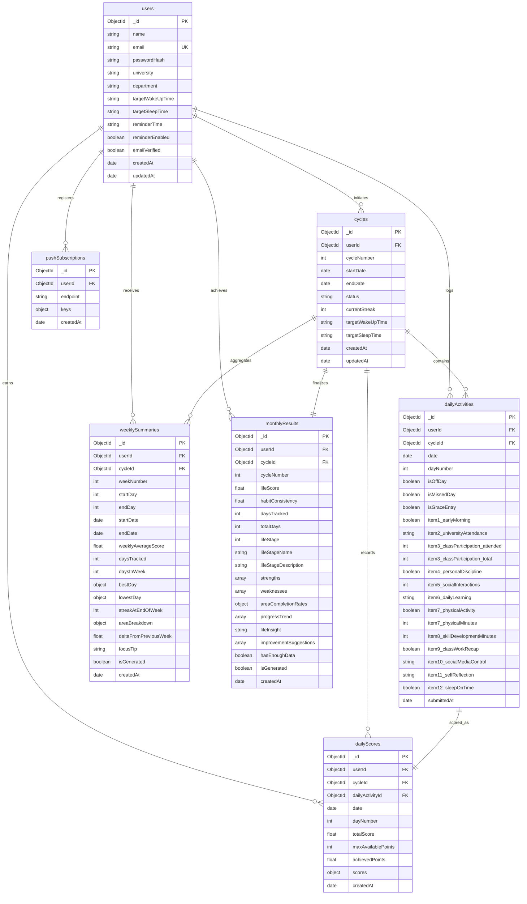

# Database Architecture & Design Specification
## Student Life Progress & Self-Improvement Tracker
**Course:** CSE 3210 (Software Engineering / App Development) · SMUCT  
**System Architecture Source:** `arcthitecture.md` (v2.0), `PRD.md` (v2.0) & `dfd.md` (v2.1)  
**Database Engine:** MongoDB 7.0+ (via Mongoose 8.0+ ODM)  
**Document:** Complete Database Model, Schemas, Aggregations, Transactions & ERD (Version 2.1 — Fully Synchronized & Verified)

---

## Table of Contents
1. [Collection List](#1-collection-list)
2. [Schema](#2-schema)
3. [Relationships](#3-relationships)
4. [Indexes](#4-indexes)
5. [Validation](#5-validation)
6. [Aggregation](#6-aggregation)
7. [Transactions (Includes Submit/Edit, Midnight Backfill & Delete)](#7-transactions)
8. [Sample Data](#8-sample-data)
9. [Mongoose Schemas (camelCase Collection Names)](#9-mongoose-schemas)
10. [ERD (Entity Relationship Diagram)](#10-erd-entity-relationship-diagram)

---

## 1. Collection List

In alignment with DFD Data Stores ($D1 \dots D7$) and System Architecture specifications, the database utilizes standardized **camelCase** collection names across all environments:

| # | Collection Name | Mongoose Model | DFD Store | Purpose / Description | Primary Key | Estimated Volume |
|---|---|---|---|---|---|---|
| 1 | `users` | `User` | **D1** | User identity, credentials, university info, and target times | `_id` (ObjectId) | 1 document per student |
| 2 | `cycles` | `Cycle` | **D2** | 30-day tracking cycles, execution status, and active consecutive streaks | `_id` (ObjectId) | 1–5 documents per student lifetime |
| 3 | `dailyActivities` | `DailyActivity` | **D3** | Raw responses for 12 life areas, journal notes, and grace entries | `_id` (ObjectId) | 30 documents per cycle |
| 4 | `dailyScores` | `DailyScore` | **D4** | Computed percentages, point breakdown, and max available points | `_id` (ObjectId) | 30 documents per cycle |
| 5 | `weeklySummaries` | `WeeklySummary` | **D5** | Aggregated 7-day analytics, $\Delta$ trends, and focused lifestyle tips | `_id` (ObjectId) | Up to 5 documents per cycle |
| 6 | `monthlyResults` | `MonthlyResult` | **D6** | 30-day Life Score, 1-of-10 Life Stage classification, and lifestyle insights | `_id` (ObjectId) | 1 document per completed cycle |
| 7 | `pushSubscriptions`| `PushSubscription`| **D7** | Web Push / VAPID endpoints and security encryption keys | `_id` (ObjectId) | 1–2 documents per user device |

---

## 2. Schema

### 2.1 Detailed Field Specifications

#### 1. `users`
*Represents student identity, access rights, and target lifestyle parameters.*
- `_id`: `ObjectId` — System-generated immutable unique identifier.
- `name`: `String` — Full name of the student ($2 \dots 100$ characters).
- `email`: `String` — Unique lowercase email address.
- `passwordHash`: `String` — bcrypt hash (cost factor: 12 salt rounds).
- `university`: `String` — Academic institution ($2 \dots 150$ characters).
- `department`: `String` — Department / Major ($2 \dots 100$ characters).
- `targetWakeUpTime`: `String` — Scheduled wake-up time in `HH:mm` format (e.g., `"06:30"`).
- `targetSleepTime`: `String` — Scheduled sleep time in `HH:mm` format (e.g., `"23:00"`).
- `reminderTime`: `String` — Preferred daily reminder time in `HH:mm` format (default: `"21:00"`).
- `reminderEnabled`: `Boolean` — Master flag for reminders (default: `true`).
- `emailVerified`: `Boolean` — Email activation status (default: `false`).
- `createdAt`: `Date` — Account creation timestamp.
- `updatedAt`: `Date` — Profile update timestamp.

#### 2. `cycles`
*Manages the 30-day calendar lifecycle and tracks current streak state.*
- `_id`: `ObjectId` — Cycle primary key.
- `userId`: `ObjectId` — Foreign key referencing `users._id`.
- `cycleNumber`: `Number` — Ordinal sequence ($1, 2, 3 \dots$).
- `startDate`: `Date` — Date of Day 1 (normalized to student local midnight).
- `endDate`: `Date` — Date of Day 30 (`startDate + 29 days`).
- `status`: `String` — Lifecycle state: `['active', 'completed', 'abandoned']` (default: `'active'`).
- `currentStreak`: `Number` — Continuous consecutive logged days (default: `0`).
- `targetWakeUpTime`: `String` — Snapshot of target wake-up time frozen at cycle creation.
- `targetSleepTime`: `String` — Snapshot of target sleep time frozen at cycle creation.
- `createdAt`: `Date` — Cycle creation timestamp.
- `updatedAt`: `Date` — Status update timestamp.

#### 3. `dailyActivities`
*Stores daily responses across 12 distinct life areas.*
- `_id`: `ObjectId` — Unique activity record ID.
- `userId`: `ObjectId` — Foreign key referencing `users._id`.
- `cycleId`: `ObjectId` — Foreign key referencing `cycles._id`.
- `date`: `Date` — Normalized calendar date (student local midnight).
- `dayNumber`: `Number` — Day in cycle ($1 \dots 30$).
- `isOffDay`: `Boolean` — `true` if university is not applicable (holiday/weekend).
- `isMissedDay`: `Boolean` — `true` if auto-generated by midnight cron backfill.
- `isGraceEntry`: `Boolean` — `true` if submitted on Day $N+1$ (yesterday grace window).
- `item1_earlyMorning`: `Boolean` — Woke up on or before `targetWakeUpTime`.
- `item2_universityAttendance`: `String` — `['yes', 'no', 'off_day']`.
- `item3_classParticipation_attended`: `Number` — Number of attended classes ($0 \dots \text{total}$).
- `item3_classParticipation_total`: `Number` — Total scheduled classes ($0$ allowed on off-days).
- `item4_personalDiscipline`: `Boolean` — Completed religious / morning routine.
- `item5_socialInteractions`: `Number` — Count of meaningful interactions ($\ge 0$).
- `item6_dailyLearning`: `String` — Reflective text note on learning (max 500 chars).
- `item7_physicalActivity`: `Boolean` — Engaged in physical exercise.
- `item7_physicalMinutes`: `Number` — Duration of exercise in minutes ($\ge 0$).
- `item8_skillDevelopmentMinutes`: `Number` — Time spent learning or building skills ($\ge 0$).
- `item9_classWorkRecap`: `Boolean` — Reviewed class material / organized notes.
- `item10_socialMediaControl`: `String` — Social media usage: `['controlled', 'useful', 'excessive']`.
- `item11_selfReflection`: `String` — Reflective journal entry (max 500 chars).
- `item12_sleepOnTime`: `Boolean` — Slept on or before `targetSleepTime`.
- `submittedAt`: `Date` — Submission timestamp.

#### 4. `dailyScores`
*Stores normalized scores, calculated points, and item-by-item breakdown.*
- `_id`: `ObjectId` — Primary key.
- `userId`: `ObjectId` — Foreign key referencing `users._id`.
- `cycleId`: `ObjectId` — Foreign key referencing `cycles._id`.
- `dailyActivityId`: `ObjectId` — Foreign key referencing `dailyActivities._id`.
- `date`: `Date` — Transaction date (local midnight).
- `dayNumber`: `Number` — Day in cycle ($1 \dots 30$).
- `totalScore`: `Number` — Final score percentage clamped to $[0.00, 100.00]$ (2 decimals).
- `maxAvailablePoints`: `Number` — Standard is `100`; on off-days items 2 & 3 are removed (`82`).
- `achievedPoints`: `Number` — Sum of achieved points across all 12 items ($0.0 \dots 100.0$).
- `scores`: `Object` — Itemized points:
  - `item1`: `Number` ($0$ or $8$)
  - `item2`: `Number` ($0$ or $10$)
  - `item3`: `Number` ($0 \dots 8$)
  - `item4`: `Number` ($0$ or $8$)
  - `item5`: `Number` ($0, 2, 4,$ or $6$)
  - `item6`: `Number` ($0$ or $10$)
  - `item7`: `Number` ($0, 5,$ or $10$)
  - `item8`: `Number` ($0, 3, 6,$ or $10$)
  - `item9`: `Number` ($0$ or $10$)
  - `item10`: `Number` ($0, 3,$ or $6$)
  - `item11`: `Number` ($0$ or $8$)
  - `item12`: `Number` ($0$ or $6$)
- `createdAt`: `Date` — Computation timestamp.

#### 5. `weeklySummaries`
*Caches compiled 7-day interval metrics, comparison trends, and targeted tips.*
- `_id`: `ObjectId` — Primary key.
- `userId`: `ObjectId` — Foreign key referencing `users._id`.
- `cycleId`: `ObjectId` — Foreign key referencing `cycles._id`.
- `weekNumber`: `Number` — Week index: $1 \dots 4$ (7 days each) or $5$ (Final Stretch: Days 29–30).
- `startDay`: `Number` — Starting day ($1, 8, 15, 22, 29$).
- `endDay`: `Number` — Ending day ($7, 14, 21, 28, 30$).
- `startDate`: `Date` — Calendar start date of the week.
- `endDate`: `Date` — Calendar end date of the week.
- `weeklyAverageScore`: `Number` — Arithmetic mean of scores for the week ($0.00 \dots 100.00$).
- `daysTracked`: `Number` — Number of days completed with score $> 0$ ($0 \dots 7$).
- `daysInWeek`: `Number` — Days in the period ($7$ for weeks 1–4; $2$ for final stretch).
- `bestDay`: `Object` — `{ date: Date, score: Number }`.
- `lowestDay`: `Object` — `{ date: Date, score: Number }`.
- `streakAtEndOfWeek`: `Number` — Consecutive streak as of the end of the week.
- `areaBreakdown`: `Object` — Average point performance percentage per area ($0.00 \dots 1.00$).
- `deltaFromPreviousWeek`: `Number` — Score difference ($\Delta \pm \%$); `null` for Week 1.
- `focusTip`: `String` — Rule-generated advice addressing the lowest-performing area.
- `isGenerated`: `Boolean` — `true` once aggregation completes.

#### 6. `monthlyResults`
*Stores 30-day Life Stage classifications, balance evaluations, and insights.*
- `_id`: `ObjectId` — Primary key.
- `userId`: `ObjectId` — Foreign key referencing `users._id`.
- `cycleId`: `ObjectId` — Foreign key referencing `cycles._id`.
- `cycleNumber`: `Number` — Sequential cycle index.
- `lifeScore`: `Number` — Mean of all 30 Daily Scores ($0.00 \dots 100.00$).
- `habitConsistency`: `Number` — Tracking rate percentage: $\frac{\text{Days Tracked}}{30} \times 100$ ($0.00 \dots 100.00$).
- `daysTracked`: `Number` — Total days logged ($0 \dots 30$).
- `totalDays`: `Number` — Fixed at `30`.
- `lifeStage`: `Number` — Classified stage ($1 \dots 10$).
- `lifeStageName`: `String` — Official stage title (e.g., `"Disciplined Student"`).
- `lifeStageDescription`: `String` — Summary description of the stage.
- `strengths`: `Array of Objects` — Top 3 performing areas: `[{ item: Number, areaName: String, completionRate: Number }]`.
- `weaknesses`: `Array of Objects` — Bottom 3 performing areas: `[{ item: Number, areaName: String, completionRate: Number }]`.
- `areaCompletionRates`: `Object` — Completion ratios for all 12 areas ($0.00 \dots 1.00$) for radar charts.
- `progressTrend`: `Array of Objects` — `[{ weekNumber: Number, averageScore: Number, daysTracked: Number }]`.
- `lifeInsight`: `String` — Predefined rule-matched personalized reflection paragraph.
- `improvementSuggestions`: `Array of Strings` — 2 to 3 targeted improvement actions for the next cycle.
- `hasEnoughData`: `Boolean` — `false` if `habitConsistency < 50%` (displays limited-data caveat).
- `isGenerated`: `Boolean` — `true` once finalized.
- `createdAt`: `Date` — Report generation timestamp.

#### 7. `pushSubscriptions`
*Manages client browser push endpoints for VAPID web notifications.*
- `_id`: `ObjectId` — Primary key.
- `userId`: `ObjectId` — Foreign key referencing `users._id`.
- `endpoint`: `String` — Browser vendor push notification endpoint URL.
- `keys`: `Object`:
  - `p256dh`: `String` — Client public encryption key.
  - `auth`: `String` — Shared authentication secret.
- `createdAt`: `Date` — Subscription timestamp.

---

## 3. Relationships

MongoDB uses referenced relationships with logical constraints to maintain referential integrity:

```
┌────────────────────────────────────────────────────────┐
│                        users                           │
└───────────┬────────────────────────────────┬───────────┘
            │ 1                              │ 1
            │                                │
            ▼ N                              ▼ N
┌────────────────────────┐       ┌───────────────────────┐
│        cycles          │       │   pushSubscriptions   │
└───────────┬────────────┘       └───────────────────────┘
            │ 1
            │
            ├────────────────────────────────┬───────────────────────────────┬──────────────────────────────┐
            ▼ N                              ▼ N                             ▼ N                            ▼ 1:1
┌────────────────────────┐       ┌───────────────────────┐       ┌───────────────────────┐      ┌───────────────────────┐
│    dailyActivities     │──────►│      dailyScores      │       │    weeklySummaries    │      │    monthlyResults     │
│                        │  1:1  │                       │       │                       │      │                       │
└────────────────────────┘       └───────────────────────┘       └───────────────────────┘      └───────────────────────┘
```

### Cardinality Rules
1. **User to Cycles (`1:N`)**: A student has one active cycle at a time and multiple completed/abandoned cycles over time.
2. **User to Push Subscriptions (`1:N`)**: A student can register multiple browser devices (desktop, mobile).
3. **Cycle to Daily Activities (`1:N`)**: Exactly 30 daily activities per complete cycle.
4. **Daily Activity to Daily Score (`1:1`)**: Every daily activity document corresponds to exactly one calculated daily score (`dailyScores.dailyActivityId` $\rightarrow$ `dailyActivities._id`).
5. **Cycle to Weekly Summaries (`1:N`)**: A cycle produces up to 5 summaries (Weeks 1, 2, 3, 4, and Final Stretch).
6. **Cycle to Monthly Result (`1:1`)**: A completed 30-day cycle produces one final monthly report.

---

## 4. Indexes

Indexes are designed to optimize query performance and enforce unique business constraints:

| Collection | Index Fields | Index Type | Purpose / Justification |
|---|---|---|---|
| `users` | `{ email: 1 }` | **Unique** | Enforces single account per email; accelerates login lookups. |
| `cycles` | `{ userId: 1, status: 1 }` | Compound | Fast retrieval of the user's active cycle: `findOne({ userId, status: 'active' })`. |
| `cycles` | `{ userId: 1, cycleNumber: 1 }` | Compound | Ordered retrieval for multi-cycle history. |
| `dailyActivities`| `{ userId: 1, date: 1 }` | **Unique Compound** | **Duplicate Prevention:** Blocks duplicate entries for the same user on the same date. |
| `dailyActivities`| `{ userId: 1, cycleId: 1, dayNumber: 1 }` | Compound | Queries daily entries within a specific cycle day range. |
| `dailyScores` | `{ userId: 1, date: 1 }` | **Unique Compound** | Ensures one calculated score per user per date. |
| `dailyScores` | `{ cycleId: 1, dayNumber: 1 }` | Compound | Fast range queries for weekly aggregation (e.g., `dayNumber: { $gte: 1, $lte: 7 }`). |
| `weeklySummaries`| `{ userId: 1, cycleId: 1, weekNumber: 1 }` | **Unique Compound** | Prevents duplicate weekly reports; accelerates cached report lookups. |
| `monthlyResults`| `{ userId: 1, cycleId: 1 }` | **Unique Compound** | Ensures only one monthly report per cycle; instant cache check. |
| `pushSubscriptions`| `{ userId: 1, endpoint: 1 }` | **Unique Compound** | Prevents duplicate push subscriptions per device. |

---

## 5. Validation

Database-level validation uses Mongoose validation rules and JSON Schema expressions to ensure data integrity without runtime type conflicts:

### 5.1 Business Validation Rules (MongoDB `$jsonSchema`)

```javascript
// Strict JSON Schema validation enforced on collection creation with flexible numeric types
db.createCollection("dailyActivities", {
  validator: {
    $jsonSchema: {
      bsonType: "object",
      required: [
        "userId", "cycleId", "date", "dayNumber", "isOffDay",
        "item1_earlyMorning", "item2_universityAttendance",
        "item4_personalDiscipline", "item5_socialInteractions",
        "item7_physicalActivity", "item8_skillDevelopmentMinutes",
        "item9_classWorkRecap", "item10_socialMediaControl",
        "item12_sleepOnTime"
      ],
      properties: {
        dayNumber: {
          bsonType: ["int", "double", "number"],
          minimum: 1,
          maximum: 30,
          description: "Must be a number between 1 and 30"
        },
        item2_universityAttendance: {
          enum: ["yes", "no", "off_day"],
          description: "Must be yes, no, or off_day"
        },
        item3_classParticipation_attended: {
          bsonType: ["int", "double", "number", "null"],
          minimum: 0,
          description: "Attended classes cannot be negative"
        },
        item3_classParticipation_total: {
          bsonType: ["int", "double", "number", "null"],
          minimum: 0,
          description: "Total classes cannot be negative (0 allowed on off-days)"
        },
        item5_socialInteractions: {
          bsonType: ["int", "double", "number"],
          minimum: 0,
          maximum: 50,
          description: "Interactions must be between 0 and 50"
        },
        item6_dailyLearning: {
          bsonType: "string",
          maxLength: 500,
          description: "Learning reflection cannot exceed 500 characters"
        },
        item7_physicalMinutes: {
          bsonType: ["int", "double", "number"],
          minimum: 0,
          maximum: 1440,
          description: "Exercise minutes cannot exceed 1440"
        },
        item8_skillDevelopmentMinutes: {
          bsonType: ["int", "double", "number"],
          minimum: 0,
          maximum: 1440,
          description: "Skill development minutes cannot exceed 1440"
        },
        item10_socialMediaControl: {
          enum: ["controlled", "useful", "excessive"],
          description: "Must be controlled, useful, or excessive"
        },
        item11_selfReflection: {
          bsonType: "string",
          maxLength: 500,
          description: "Journal reflection cannot exceed 500 characters"
        }
      }
    }
  }
});
```

### 5.2 Application-Level Guards
1. **Fraction Guard (Class Participation)**: Attended classes must be $\le$ Total classes ($a \le b$). Total classes can be $0$ only on off-days.
2. **Text Field Sanitization**: Free-text fields (`item6_dailyLearning`, `item11_selfReflection`) strip HTML and trim whitespace to protect against XSS and control document sizes.
3. **Score Clamping**: Scores are clamped to $[0.00, 100.00]$ using `Math.max(0, Math.min(100, score))` before saving.

---

## 6. Aggregation

The system uses aggregation pipelines for weekly and monthly report compilation:

### 6.1 Weekly Aggregation Pipeline
*Calculates weekly average score, best day, lowest day, and area performance for a week range.*

```javascript
const aggregateWeek = async (userId, cycleId, startDay, endDay) => {
  const result = await mongoose.model('DailyScore').aggregate([
    {
      $match: {
        userId: new mongoose.Types.ObjectId(userId),
        cycleId: new mongoose.Types.ObjectId(cycleId),
        dayNumber: { $gte: startDay, $lte: endDay }
      }
    },
    {
      $group: {
        _id: "$cycleId",
        weeklyAverageScore: { $avg: "$totalScore" },
        daysTracked: {
          $sum: { $cond: [{ $gt: ["$totalScore", 0] }, 1, 0] }
        },
        bestDayScore: { $max: "$totalScore" },
        lowestDayScore: { $min: "$totalScore" },
        // Average point ratio per area
        avgItem1: { $avg: { $divide: ["$scores.item1", 8] } },
        avgItem2: { $avg: { $divide: ["$scores.item2", 10] } },
        avgItem3: { $avg: { $divide: ["$scores.item3", 8] } },
        avgItem4: { $avg: { $divide: ["$scores.item4", 8] } },
        avgItem5: { $avg: { $divide: ["$scores.item5", 6] } },
        avgItem6: { $avg: { $divide: ["$scores.item6", 10] } },
        avgItem7: { $avg: { $divide: ["$scores.item7", 10] } },
        avgItem8: { $avg: { $divide: ["$scores.item8", 10] } },
        avgItem9: { $avg: { $divide: ["$scores.item9", 10] } },
        avgItem10: { $avg: { $divide: ["$scores.item10", 6] } },
        avgItem11: { $avg: { $divide: ["$scores.item11", 8] } },
        avgItem12: { $avg: { $divide: ["$scores.item12", 6] } }
      }
    },
    {
      $project: {
        _id: 0,
        weeklyAverageScore: { $round: ["$weeklyAverageScore", 2] },
        daysTracked: 1,
        bestDayScore: 1,
        lowestDayScore: 1,
        areaBreakdown: {
          item1: { $round: ["$avgItem1", 2] },
          item2: { $round: ["$avgItem2", 2] },
          item3: { $round: ["$avgItem3", 2] },
          item4: { $round: ["$avgItem4", 2] },
          item5: { $round: ["$avgItem5", 2] },
          item6: { $round: ["$avgItem6", 2] },
          item7: { $round: ["$avgItem7", 2] },
          item8: { $round: ["$avgItem8", 2] },
          item9: { $round: ["$avgItem9", 2] },
          item10: { $round: ["$avgItem10", 2] },
          item11: { $round: ["$avgItem11", 2] },
          item12: { $round: ["$avgItem12", 2] }
        }
      }
    }
  ]);
  return result[0];
};
```

### 6.2 Monthly Ranking Pipeline (Top Strengths & Weaknesses)
*Ranks the 12 life areas by completion rate to find the top 3 strengths and bottom 3 weaknesses.*

```javascript
const aggregateMonthlyStrengthsWeaknesses = async (userId, cycleId) => {
  const areaAverages = await mongoose.model('DailyScore').aggregate([
    {
      $match: {
        userId: new mongoose.Types.ObjectId(userId),
        cycleId: new mongoose.Types.ObjectId(cycleId)
      }
    },
    {
      $group: {
        _id: null,
        item1: { $avg: { $divide: ["$scores.item1", 8] } },
        item2: { $avg: { $divide: ["$scores.item2", 10] } },
        item3: { $avg: { $divide: ["$scores.item3", 8] } },
        item4: { $avg: { $divide: ["$scores.item4", 8] } },
        item5: { $avg: { $divide: ["$scores.item5", 6] } },
        item6: { $avg: { $divide: ["$scores.item6", 10] } },
        item7: { $avg: { $divide: ["$scores.item7", 10] } },
        item8: { $avg: { $divide: ["$scores.item8", 10] } },
        item9: { $avg: { $divide: ["$scores.item9", 10] } },
        item10: { $avg: { $divide: ["$scores.item10", 6] } },
        item11: { $avg: { $divide: ["$scores.item11", 8] } },
        item12: { $avg: { $divide: ["$scores.item12", 6] } }
      }
    },
    {
      $project: {
        _id: 0,
        areas: [
          { item: 1, areaName: "Early Morning", completionRate: { $round: ["$item1", 2] } },
          { item: 2, areaName: "University Attendance", completionRate: { $round: ["$item2", 2] } },
          { item: 3, areaName: "Class Participation", completionRate: { $round: ["$item3", 2] } },
          { item: 4, areaName: "Personal Discipline", completionRate: { $round: ["$item4", 2] } },
          { item: 5, areaName: "Social Interaction", completionRate: { $round: ["$item5", 2] } },
          { item: 6, areaName: "Daily Learning", completionRate: { $round: ["$item6", 2] } },
          { item: 7, areaName: "Physical Activity", completionRate: { $round: ["$item7", 2] } },
          { item: 8, areaName: "Skill Development", completionRate: { $round: ["$item8", 2] } },
          { item: 9, areaName: "Class Work Recap", completionRate: { $round: ["$item9", 2] } },
          { item: 10, areaName: "Social Media Control", completionRate: { $round: ["$item10", 2] } },
          { item: 11, areaName: "Self-Reflection", completionRate: { $round: ["$item11", 2] } },
          { item: 12, areaName: "Sleeping on Time", completionRate: { $round: ["$item12", 2] } }
        ]
      }
    },
    { $unwind: "$areas" },
    { $sort: { "areas.completionRate": -1 } },
    {
      $group: {
        _id: null,
        sortedAreas: { $push: "$areas" }
      }
    },
    {
      $project: {
        _id: 0,
        strengths: { $slice: ["$sortedAreas", 3] }, // Top 3
        weaknesses: { $slice: ["$sortedAreas", -3] } // Bottom 3
      }
    }
  ]);
  return areaAverages[0];
};
```

---

## 7. Transactions

MongoDB multi-document ACID transactions ensure operations complete atomically across collections without race conditions:

### 7.1 Daily Checklist Submission & Safe Edit Transaction
*Handles both brand-new submissions and same-day/grace-day updates (`PUT /today`, `PUT /yesterday`). Increases the streak ONLY on new day entries to prevent duplicate increments.*

```javascript
const saveDailyChecklistTransaction = async (userId, cycleId, payload, scoreResult, isUpdate = false) => {
  const session = await mongoose.startSession();
  session.startTransaction();
  try {
    let activity;
    let score;

    if (isUpdate) {
      // 1. UPDATE Mode: Edit existing entry (same-day or grace-day edit)
      activity = await mongoose.model('DailyActivity').findOneAndUpdate(
        { userId, date: payload.normalizedDate },
        {
          $set: {
            ...payload.items,
            isOffDay: payload.isOffDay,
            submittedAt: new Date()
          }
        },
        { session, new: true }
      );

      score = await mongoose.model('DailyScore').findOneAndUpdate(
        { userId, date: payload.normalizedDate },
        { $set: scoreResult },
        { session, new: true }
      );
      // NOTE: Streak is NOT incremented during same-day edits
    } else {
      // 2. INSERT Mode: First submission for today
      [activity] = await mongoose.model('DailyActivity').create(
        [{
          userId,
          cycleId,
          date: payload.normalizedDate,
          dayNumber: payload.dayNumber,
          isOffDay: payload.isOffDay,
          isGraceEntry: payload.isGraceEntry || false,
          ...payload.items,
          submittedAt: new Date()
        }],
        { session }
      );

      [score] = await mongoose.model('DailyScore').create(
        [{
          userId,
          cycleId,
          dailyActivityId: activity._id,
          date: payload.normalizedDate,
          dayNumber: payload.dayNumber,
          ...scoreResult
        }],
        { session }
      );

      // Increment streak ONLY on brand-new date submission
      await mongoose.model('Cycle').updateOne(
        { _id: cycleId, userId },
        { $inc: { currentStreak: 1 } },
        { session }
      );
    }

    // Auto-complete cycle if Day 30 is reached
    if (payload.dayNumber === 30) {
      await mongoose.model('Cycle').updateOne(
        { _id: cycleId },
        { $set: { status: 'completed' } },
        { session }
      );
    }

    await session.commitTransaction();
    const cycle = await mongoose.model('Cycle').findById(cycleId);
    return { activity, score, streak: cycle.currentStreak };
  } catch (error) {
    await session.abortTransaction();
    throw error;
  } finally {
    session.endSession();
  }
};
```

### 7.2 Midnight Missed-Day Backfill & Streak Reset Transaction
*Executed by `node-cron` at 00:00. Automatically creates a 0% score record and resets the streak if a day was skipped past the grace window.*

```javascript
const midnightMissedDayBackfillTransaction = async (userId, cycleId, missedDate, dayNumber) => {
  const session = await mongoose.startSession();
  session.startTransaction();
  try {
    // 1. Create a dummy missed activity record
    const [activity] = await mongoose.model('DailyActivity').create(
      [{
        userId,
        cycleId,
        date: missedDate,
        dayNumber,
        isOffDay: false,
        isMissedDay: true,
        submittedAt: new Date()
      }],
      { session }
    );

    // 2. Create 0% score record
    await mongoose.model('DailyScore').create(
      [{
        userId,
        cycleId,
        dailyActivityId: activity._id,
        date: missedDate,
        dayNumber,
        totalScore: 0.0,
        maxAvailablePoints: 100,
        achievedPoints: 0.0,
        scores: {
          item1: 0, item2: 0, item3: 0, item4: 0, item5: 0, item6: 0,
          item7: 0, item8: 0, item9: 0, item10: 0, item11: 0, item12: 0
        }
      }],
      { session }
    );

    // 3. Reset consecutive streak to 0 in cycles collection
    await mongoose.model('Cycle').updateOne(
      { _id: cycleId, userId },
      { $set: { currentStreak: 0 } },
      { session }
    );

    await session.commitTransaction();
    return { success: true, backfilledDate: missedDate };
  } catch (error) {
    await session.abortTransaction();
    throw error;
  } finally {
    session.endSession();
  }
};
```

### 7.3 Account Deletion Cascading Transaction
*Permanently removes all personal and activity data across all collections.*

```javascript
const deleteUserAccountTransaction = async (userId) => {
  const session = await mongoose.startSession();
  session.startTransaction();
  try {
    const userObjId = new mongoose.Types.ObjectId(userId);

    await mongoose.model('DailyScore').deleteMany({ userId: userObjId }, { session });
    await mongoose.model('DailyActivity').deleteMany({ userId: userObjId }, { session });
    await mongoose.model('WeeklySummary').deleteMany({ userId: userObjId }, { session });
    await mongoose.model('MonthlyResult').deleteMany({ userId: userObjId }, { session });
    await mongoose.model('PushSubscription').deleteMany({ userId: userObjId }, { session });
    await mongoose.model('Cycle').deleteMany({ userId: userObjId }, { session });
    await mongoose.model('User').deleteOne({ _id: userObjId }, { session });

    await session.commitTransaction();
    return { success: true };
  } catch (error) {
    await session.abortTransaction();
    throw error;
  } finally {
    session.endSession();
  }
};
```

---

## 8. Sample Data

Production-grade JSON mock documents representing complete records across all 7 collections:

### 8.1 `users`
```json
{
  "_id": { "$oid": "655b1a1f4f1c2d0012a4b801" },
  "name": "Md. Mahfuzur Rahman Milon",
  "email": "milon.cse@smuct.edu.bd",
  "passwordHash": "$2a$12$e8Yk2uM1d6kP91nJ9Z7bA.Y7j2W9K8P3Q1Z6L4N8M0X2C4V6B8N0.",
  "university": "Shanto-Mariam University of Creative Technology",
  "department": "Computer Science & Engineering",
  "targetWakeUpTime": "06:30",
  "targetSleepTime": "23:00",
  "reminderTime": "21:30",
  "reminderEnabled": true,
  "emailVerified": true,
  "createdAt": { "$date": "2026-11-01T08:00:00.000Z" },
  "updatedAt": { "$date": "2026-11-01T08:00:00.000Z" }
}
```

### 8.2 `cycles`
```json
{
  "_id": { "$oid": "655b1b3a4f1c2d0012a4b802" },
  "userId": { "$oid": "655b1a1f4f1c2d0012a4b801" },
  "cycleNumber": 1,
  "startDate": { "$date": "2026-11-01T00:00:00.000Z" },
  "endDate": { "$date": "2026-11-30T00:00:00.000Z" },
  "status": "active",
  "currentStreak": 14,
  "targetWakeUpTime": "06:30",
  "targetSleepTime": "23:00",
  "createdAt": { "$date": "2026-11-01T00:00:00.000Z" },
  "updatedAt": { "$date": "2026-11-14T22:00:00.000Z" }
}
```

### 8.3 `dailyActivities`
```json
{
  "_id": { "$oid": "655b204e4f1c2d0012a4b803" },
  "userId": { "$oid": "655b1a1f4f1c2d0012a4b801" },
  "cycleId": { "$oid": "655b1b3a4f1c2d0012a4b802" },
  "date": { "$date": "2026-11-14T00:00:00.000Z" },
  "dayNumber": 14,
  "isOffDay": false,
  "isMissedDay": false,
  "isGraceEntry": false,
  "item1_earlyMorning": true,
  "item2_universityAttendance": "yes",
  "item3_classParticipation_attended": 4,
  "item3_classParticipation_total": 4,
  "item4_personalDiscipline": true,
  "item5_socialInteractions": 4,
  "item6_dailyLearning": "Learned indexing and aggregation pipelines in MongoDB.",
  "item7_physicalActivity": true,
  "item7_physicalMinutes": 30,
  "item8_skillDevelopmentMinutes": 75,
  "item9_classWorkRecap": true,
  "item10_socialMediaControl": "controlled",
  "item11_selfReflection": "Felt productive today; balanced coursework with coding practice.",
  "item12_sleepOnTime": true,
  "submittedAt": { "$date": "2026-11-14T21:45:00.000Z" }
}
```

### 8.4 `dailyScores`
```json
{
  "_id": { "$oid": "655b204e4f1c2d0012a4b804" },
  "userId": { "$oid": "655b1a1f4f1c2d0012a4b801" },
  "cycleId": { "$oid": "655b1b3a4f1c2d0012a4b802" },
  "dailyActivityId": { "$oid": "655b204e4f1c2d0012a4b803" },
  "date": { "$date": "2026-11-14T00:00:00.000Z" },
  "dayNumber": 14,
  "totalScore": 100.0,
  "maxAvailablePoints": 100,
  "achievedPoints": 100.0,
  "scores": {
    "item1": 8,
    "item2": 10,
    "item3": 8,
    "item4": 8,
    "item5": 6,
    "item6": 10,
    "item7": 10,
    "item8": 10,
    "item9": 10,
    "item10": 6,
    "item11": 8,
    "item12": 6
  },
  "createdAt": { "$date": "2026-11-14T21:45:01.000Z" }
}
```

### 8.5 `weeklySummaries`
```json
{
  "_id": { "$oid": "655b23a14f1c2d0012a4b805" },
  "userId": { "$oid": "655b1a1f4f1c2d0012a4b801" },
  "cycleId": { "$oid": "655b1b3a4f1c2d0012a4b802" },
  "weekNumber": 2,
  "startDay": 8,
  "endDay": 14,
  "startDate": { "$date": "2026-11-08T00:00:00.000Z" },
  "endDate": { "$date": "2026-11-14T00:00:00.000Z" },
  "weeklyAverageScore": 88.5,
  "daysTracked": 7,
  "daysInWeek": 7,
  "bestDay": { "date": { "$date": "2026-11-14T00:00:00.000Z" }, "score": 100.0 },
  "lowestDay": { "date": { "$date": "2026-11-09T00:00:00.000Z" }, "score": 76.0 },
  "streakAtEndOfWeek": 14,
  "areaBreakdown": {
    "item1": 0.86,
    "item2": 1.00,
    "item3": 0.95,
    "item4": 0.88,
    "item5": 0.80,
    "item6": 1.00,
    "item7": 0.70,
    "item8": 0.85,
    "item9": 0.90,
    "item10": 0.75,
    "item11": 0.90,
    "item12": 0.80
  },
  "deltaFromPreviousWeek": 6.5,
  "focusTip": "Consider increasing physical activity time to at least 15 minutes daily for better balance.",
  "isGenerated": true,
  "createdAt": { "$date": "2026-11-14T23:59:00.000Z" }
}
```

### 8.6 `monthlyResults`
```json
{
  "_id": { "$oid": "655b34f04f1c2d0012a4b806" },
  "userId": { "$oid": "655b1a1f4f1c2d0012a4b801" },
  "cycleId": { "$oid": "655b1b3a4f1c2d0012a4b802" },
  "cycleNumber": 1,
  "lifeScore": 86.4,
  "habitConsistency": 96.67,
  "daysTracked": 29,
  "totalDays": 30,
  "lifeStage": 8,
  "lifeStageName": "High Achiever",
  "lifeStageDescription": "Demonstrates strong discipline and balanced consistency across academic and personal habits.",
  "strengths": [
    { "item": 2, "areaName": "University Attendance", "completionRate": 0.98 },
    { "item": 6, "areaName": "Daily Learning", "completionRate": 0.95 },
    { "item": 9, "areaName": "Class Work Recap", "completionRate": 0.92 }
  ],
  "weaknesses": [
    { "item": 7, "areaName": "Physical Activity", "completionRate": 0.65 },
    { "item": 10, "areaName": "Social Media Control", "completionRate": 0.70 },
    { "item": 12, "areaName": "Sleeping on Time", "completionRate": 0.72 }
  ],
  "areaCompletionRates": {
    "item1": 0.88,
    "item2": 0.98,
    "item3": 0.90,
    "item4": 0.85,
    "item5": 0.82,
    "item6": 0.95,
    "item7": 0.65,
    "item8": 0.84,
    "item9": 0.92,
    "item10": 0.70,
    "item11": 0.88,
    "item12": 0.72
  },
  "progressTrend": [
    { "weekNumber": 1, "averageScore": 82.0, "daysTracked": 7 },
    { "weekNumber": 2, "averageScore": 88.5, "daysTracked": 7 },
    { "weekNumber": 3, "averageScore": 85.0, "daysTracked": 7 },
    { "weekNumber": 4, "averageScore": 89.0, "daysTracked": 7 },
    { "weekNumber": 5, "averageScore": 91.0, "daysTracked": 1 }
  ],
  "lifeInsight": "During the last 30 days, your academic consistency and daily learning habits were exceptional. Physical activity and sleep timing showed some variance. Maintaining your current study discipline while setting a firmer bedtime will help you reach Stage 9.",
  "improvementSuggestions": [
    "Schedule 20 minutes of daily physical exercise before afternoon study sessions.",
    "Place your phone away from the bed 30 minutes before your target sleep time.",
    "Maintain your high university attendance rate into the next cycle."
  ],
  "hasEnoughData": true,
  "isGenerated": true,
  "createdAt": { "$date": "2026-11-30T23:59:59.000Z" }
}
```

### 8.7 `pushSubscriptions`
```json
{
  "_id": { "$oid": "655b39014f1c2d0012a4b807" },
  "userId": { "$oid": "655b1a1f4f1c2d0012a4b801" },
  "endpoint": "https://fcm.googleapis.com/fcm/send/eXampleEndpoint123",
  "keys": {
    "p256dh": "BNcRdreALRF8FsEteGUn3N_JqcQSwPP3YoPrqUTNqnyStYwcFA29eKnstpkunf47n4YgHpt1",
    "auth": "tBHItSI1Wj5ixk3eA2uvBw"
  },
  "createdAt": { "$date": "2026-11-01T08:05:00.000Z" }
}
```

---

## 9. Mongoose Schemas

Ready-to-use production JavaScript code using Mongoose 8.0+ with explicitly declared camelCase collection names:

```javascript
const mongoose = require('mongoose');
const { Schema } = mongoose;

// ==========================================
// 1. USER SCHEMA
// ==========================================
const userSchema = new Schema(
  {
    name: { type: String, required: true, trim: true, minlength: 2, maxlength: 100 },
    email: { type: String, required: true, unique: true, lowercase: true, trim: true },
    passwordHash: { type: String, required: true },
    university: { type: String, required: true, trim: true, maxlength: 150 },
    department: { type: String, required: true, trim: true, maxlength: 100 },
    targetWakeUpTime: {
      type: String,
      default: '06:30',
      match: [/^([0-1]?[0-9]|2[0-3]):[0-5][0-9]$/, 'Invalid time format (HH:mm)']
    },
    targetSleepTime: {
      type: String,
      default: '23:00',
      match: [/^([0-1]?[0-9]|2[0-3]):[0-5][0-9]$/, 'Invalid time format (HH:mm)']
    },
    reminderTime: {
      type: String,
      default: '21:00',
      match: [/^([0-1]?[0-9]|2[0-3]):[0-5][0-9]$/, 'Invalid time format (HH:mm)']
    },
    reminderEnabled: { type: Boolean, default: true },
    emailVerified: { type: Boolean, default: false }
  },
  { timestamps: true, collection: 'users' }
);

// ==========================================
// 2. CYCLE SCHEMA
// ==========================================
const cycleSchema = new Schema(
  {
    userId: { type: Schema.Types.ObjectId, ref: 'User', required: true, index: true },
    cycleNumber: { type: Number, required: true, default: 1 },
    startDate: { type: Date, required: true },
    endDate: { type: Date, required: true },
    status: {
      type: String,
      enum: ['active', 'completed', 'abandoned'],
      default: 'active'
    },
    currentStreak: { type: Number, default: 0, min: 0 },
    targetWakeUpTime: { type: String, required: true },
    targetSleepTime: { type: String, required: true }
  },
  { timestamps: true, collection: 'cycles' }
);
cycleSchema.index({ userId: 1, status: 1 });
cycleSchema.index({ userId: 1, cycleNumber: 1 });

// ==========================================
// 3. DAILY ACTIVITY SCHEMA
// ==========================================
const dailyActivitySchema = new Schema(
  {
    userId: { type: Schema.Types.ObjectId, ref: 'User', required: true, index: true },
    cycleId: { type: Schema.Types.ObjectId, ref: 'Cycle', required: true, index: true },
    date: { type: Date, required: true },
    dayNumber: { type: Number, required: true, min: 1, max: 30 },
    isOffDay: { type: Boolean, default: false },
    isMissedDay: { type: Boolean, default: false },
    isGraceEntry: { type: Boolean, default: false },

    // 12 Life Areas
    item1_earlyMorning: { type: Boolean, default: false },
    item2_universityAttendance: {
      type: String,
      enum: ['yes', 'no', 'off_day'],
      default: 'no'
    },
    item3_classParticipation_attended: { type: Number, default: 0, min: 0 },
    item3_classParticipation_total: { type: Number, default: 0, min: 0 },
    item4_personalDiscipline: { type: Boolean, default: false },
    item5_socialInteractions: { type: Number, default: 0, min: 0, max: 50 },
    item6_dailyLearning: { type: String, trim: true, maxlength: 500, default: '' },
    item7_physicalActivity: { type: Boolean, default: false },
    item7_physicalMinutes: { type: Number, default: 0, min: 0, max: 1440 },
    item8_skillDevelopmentMinutes: { type: Number, default: 0, min: 0, max: 1440 },
    item9_classWorkRecap: { type: Boolean, default: false },
    item10_socialMediaControl: {
      type: String,
      enum: ['controlled', 'useful', 'excessive'],
      default: 'controlled'
    },
    item11_selfReflection: { type: String, trim: true, maxlength: 500, default: '' },
    item12_sleepOnTime: { type: Boolean, default: false },

    submittedAt: { type: Date, default: Date.now }
  },
  { timestamps: true, collection: 'dailyActivities' }
);
// Duplicate Prevention: Exactly one entry per user per date
dailyActivitySchema.index({ userId: 1, date: 1 }, { unique: true });
dailyActivitySchema.index({ userId: 1, cycleId: 1, dayNumber: 1 });

// ==========================================
// 4. DAILY SCORE SCHEMA
// ==========================================
const dailyScoreSchema = new Schema(
  {
    userId: { type: Schema.Types.ObjectId, ref: 'User', required: true, index: true },
    cycleId: { type: Schema.Types.ObjectId, ref: 'Cycle', required: true, index: true },
    dailyActivityId: { type: Schema.Types.ObjectId, ref: 'DailyActivity', required: true },
    date: { type: Date, required: true },
    dayNumber: { type: Number, required: true, min: 1, max: 30 },
    totalScore: { type: Number, required: true, min: 0, max: 100 },
    maxAvailablePoints: { type: Number, required: true, enum: [100, 82] },
    achievedPoints: { type: Number, required: true, min: 0, max: 100 },
    scores: {
      item1: { type: Number, default: 0 },
      item2: { type: Number, default: 0 },
      item3: { type: Number, default: 0 },
      item4: { type: Number, default: 0 },
      item5: { type: Number, default: 0 },
      item6: { type: Number, default: 0 },
      item7: { type: Number, default: 0 },
      item8: { type: Number, default: 0 },
      item9: { type: Number, default: 0 },
      item10: { type: Number, default: 0 },
      item11: { type: Number, default: 0 },
      item12: { type: Number, default: 0 }
    }
  },
  { timestamps: true, collection: 'dailyScores' }
);
dailyScoreSchema.index({ userId: 1, date: 1 }, { unique: true });
dailyScoreSchema.index({ cycleId: 1, dayNumber: 1 });

// ==========================================
// 5. WEEKLY SUMMARY SCHEMA
// ==========================================
const weeklySummarySchema = new Schema(
  {
    userId: { type: Schema.Types.ObjectId, ref: 'User', required: true, index: true },
    cycleId: { type: Schema.Types.ObjectId, ref: 'Cycle', required: true, index: true },
    weekNumber: { type: Number, required: true, min: 1, max: 5 },
    startDay: { type: Number, required: true },
    endDay: { type: Number, required: true },
    startDate: { type: Date, required: true },
    endDate: { type: Date, required: true },
    weeklyAverageScore: { type: Number, required: true, min: 0, max: 100 },
    daysTracked: { type: Number, required: true, min: 0, max: 7 },
    daysInWeek: { type: Number, required: true, enum: [7, 2] },
    bestDay: {
      date: { type: Date },
      score: { type: Number }
    },
    lowestDay: {
      date: { type: Date },
      score: { type: Number }
    },
    streakAtEndOfWeek: { type: Number, default: 0 },
    areaBreakdown: {
      item1: Number, item2: Number, item3: Number, item4: Number,
      item5: Number, item6: Number, item7: Number, item8: Number,
      item9: Number, item10: Number, item11: Number, item12: Number
    },
    deltaFromPreviousWeek: { type: Number, default: null },
    focusTip: { type: String, default: '' },
    isGenerated: { type: Boolean, default: false }
  },
  { timestamps: true, collection: 'weeklySummaries' }
);
weeklySummarySchema.index({ userId: 1, cycleId: 1, weekNumber: 1 }, { unique: true });

// ==========================================
// 6. MONTHLY RESULT SCHEMA
// ==========================================
const monthlyResultSchema = new Schema(
  {
    userId: { type: Schema.Types.ObjectId, ref: 'User', required: true, index: true },
    cycleId: { type: Schema.Types.ObjectId, ref: 'Cycle', required: true, index: true },
    cycleNumber: { type: Number, required: true },
    lifeScore: { type: Number, required: true, min: 0, max: 100 },
    habitConsistency: { type: Number, required: true, min: 0, max: 100 },
    daysTracked: { type: Number, required: true, min: 0, max: 30 },
    totalDays: { type: Number, default: 30 },
    lifeStage: { type: Number, required: true, min: 1, max: 10 },
    lifeStageName: { type: String, required: true },
    lifeStageDescription: { type: String, required: true },
    strengths: [
      {
        item: Number,
        areaName: String,
        completionRate: Number
      }
    ],
    weaknesses: [
      {
        item: Number,
        areaName: String,
        completionRate: Number
      }
    ],
    areaCompletionRates: {
      item1: Number, item2: Number, item3: Number, item4: Number,
      item5: Number, item6: Number, item7: Number, item8: Number,
      item9: Number, item10: Number, item11: Number, item12: Number
    },
    progressTrend: [
      {
        weekNumber: Number,
        averageScore: Number,
        daysTracked: Number
      }
    ],
    lifeInsight: { type: String, required: true },
    improvementSuggestions: [{ type: String }],
    hasEnoughData: { type: Boolean, default: true },
    isGenerated: { type: Boolean, default: false }
  },
  { timestamps: true, collection: 'monthlyResults' }
);
monthlyResultSchema.index({ userId: 1, cycleId: 1 }, { unique: true });

// ==========================================
// 7. PUSH SUBSCRIPTION SCHEMA
// ==========================================
const pushSubscriptionSchema = new Schema(
  {
    userId: { type: Schema.Types.ObjectId, ref: 'User', required: true, index: true },
    endpoint: { type: String, required: true },
    keys: {
      p256dh: { type: String, required: true },
      auth: { type: String, required: true }
    }
  },
  { timestamps: true, collection: 'pushSubscriptions' }
);
pushSubscriptionSchema.index({ userId: 1, endpoint: 1 }, { unique: true });

// Export Models
module.exports = {
  User: mongoose.model('User', userSchema),
  Cycle: mongoose.model('Cycle', cycleSchema),
  DailyActivity: mongoose.model('DailyActivity', dailyActivitySchema),
  DailyScore: mongoose.model('DailyScore', dailyScoreSchema),
  WeeklySummary: mongoose.model('WeeklySummary', weeklySummarySchema),
  MonthlyResult: mongoose.model('MonthlyResult', monthlyResultSchema),
  PushSubscription: mongoose.model('PushSubscription', pushSubscriptionSchema)
};
```

---

## 10. ERD (Entity Relationship Diagram)


