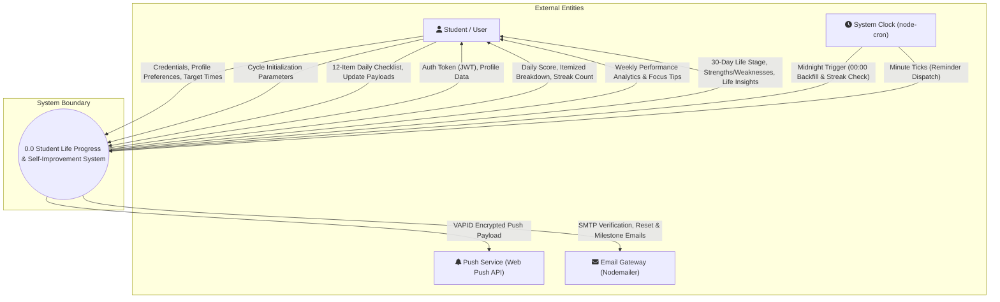
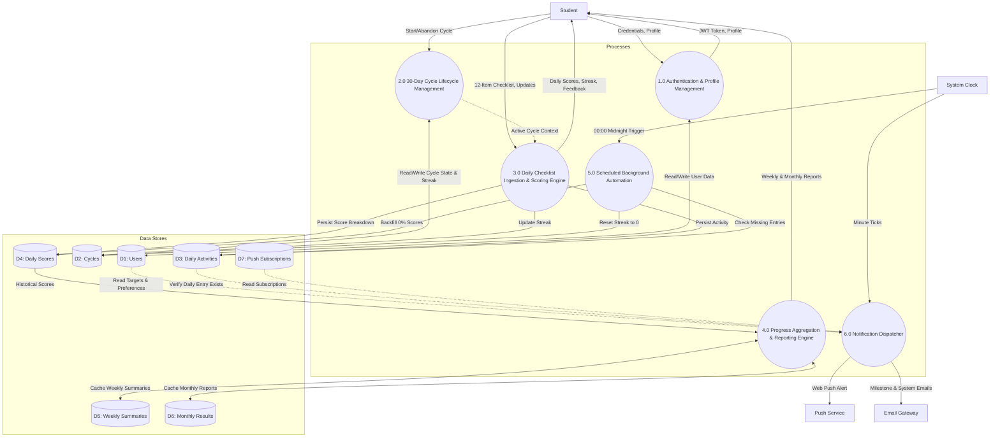
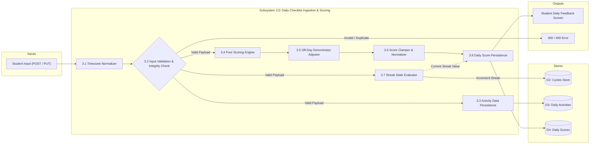

# Data Flow Diagram (DFD) Specification
## Student Life Progress & Self-Improvement Tracker
**Course:** CSE 3210 (Software Engineering / App Development) · SMUCT  
**System Architecture Source:** `arcthitecture.md` (Version 2.0) & `PRD.md` (Version 2.0)  
**Document:** Complete DFD Modeling, Data Dictionary, Schemas, Diagrams & Validation (Version 2.1 — Fully Synchronized)

---

## Table of Contents
1. [Context Diagram (Level 0 DFD)](#1-context-diagram-level-0-dfd)
2. [Level 1 DFD (Subsystem Breakdown)](#2-level-1-dfd-subsystem-breakdown)
3. [Level 2 DFD (Deep-Dive Core Processes)](#3-level-2-dfd-deep-dive-core-processes)
   - 3.1 Subsystem 3.0: Daily Checklist Ingestion & Scoring Engine
   - 3.2 Subsystem 4.0: Aggregation & Life Stage Reporting Subsystem
4. [Data Dictionary](#4-data-dictionary)
5. [Data Flow Table](#5-data-flow-table)
6. [Process Table (Fully Synchronized)](#6-process-table-fully-synchronized)
7. [Data Store Table](#7-data-store-table)
8. [Mermaid Diagrams](#8-mermaid-diagrams)
9. [Draw.io XML Specification (Includes D7 & All Connectors)](#9-drawio-xml-specification)
10. [Validation & Verification Report](#10-validation--verification-report)

---

## 1. Context Diagram (Level 0 DFD)

The Context Diagram defines the system boundary for the **Student Life Progress & Self-Improvement Tracker**. It represents the entire application as a single process interacting with external entities.

### External Entities
1. **Student / User**: Authenticates, initializes cycles, inputs daily lifestyle habits, edits entries, and views reports/scores.
2. **Push Service (Web Push / VAPID)**: Receives scheduled notification payloads and delivers in-browser alerts to active student subscriptions.
3. **Email Gateway (SMTP / Nodemailer)**: Dispatches verification emails, password recovery links, and milestone certificates.
4. **System Clock / Cron Scheduler (node-cron)**: Dispatches automated time-based events (midnight missed-day trigger and per-minute reminder evaluator).

### Level 0 Interactions
- **Student $\rightarrow$ System**: Credentials, Profile & Target Times, Cycle Start Parameters, 12-Item Checklist Data, Update Requests.
- **System $\rightarrow$ Student**: JWT Authentication Token, Real-time Daily Scores & Breakdowns, Streak Counters, Weekly Analytics, 30-Day Life Stage & Lifestyle Insights.
- **System Clock $\rightarrow$ System**: Midnight Trigger (00:00 local offset), Scheduled Reminder Dispatch Interval.
- **System $\rightarrow$ Push Service**: VAPID Encrypted Push Payload (Notification Title, Body, Action URLs).
- **System $\rightarrow$ Email Gateway**: SMTP Transactional Email Data (Recipient, Template, Subject).

---

## 2. Level 1 DFD (Subsystem Breakdown)

The Level 1 diagram explodes Process 0 into **six major operational processes** and maps data stores:

```
[Student]
  │  ▲
  │  │  (Auth, Tokens, Profile)
  ▼  │
(1.0 Authentication & User Profile Management) ◄═══► [D1: Users Store]
  │
  │ (User Context: userId, Target Times)
  ▼
(2.0 30-Day Cycle Lifecycle Management) ◄═══════════► [D2: Cycles Store]
  │
  │ (Active Cycle Context: cycleId, dayNumber)
  ▼
(3.0 Daily Checklist Ingestion & Scoring Engine) ◄══► [D3: Daily Activities]
  │                                              ◄══► [D4: Daily Scores]
  │                                              ◄══► [D2: Cycles Store (Streak update)]
  │
  │ (Calculated Daily Scores, Historical Trend)
  ▼
(4.0 Progress Aggregation & Reporting Engine) ◄═════► [D5: Weekly Summaries]
  │                                           ◄═════► [D6: Monthly Results]
  │
  ├───────────────────────────────────────────────────────┐
  ▼                                                       ▼
(5.0 Scheduled Background Automation)      (6.0 Notification Dispatcher)
  ▲                                           ▲           │
  │ (Cron: 0 0 * * *)                         │ (Cron)    │
[System Clock]                 [D7: Push Subscriptions]   ▼
                                           [Web Push / Email Gateway]
```

### Process Definitions (Level 1)
- **1.0 Auth & Profile**: Manages registration, password hashing (bcrypt), email verification, and profile target times.
- **2.0 Cycle Management**: Calculates day sequence ($1 \dots 30$), cycle status (`active`, `completed`, `abandoned`), persistent streak tracking, and historical archives.
- **3.0 Daily Checklist & Scoring**: Receives the 12-item checklist, validates inputs, evaluates deterministic points, updates the streak, and clamps total daily score.
- **4.0 Progress Aggregation & Reporting**: Compiles 7-day weekly summaries, trends, 30-day Life Stage classification, and rule-based insights.
- **5.0 Scheduled Background Automation**: Detects unrecorded dates after the grace window, backfills missed days with 0% scores, and resets the active streak in D2.
- **6.0 Notification Dispatcher**: Evaluates reminder criteria and sends web push or email alerts using subscription keys in D7.

---

## 3. Level 2 DFD (Deep-Dive Core Processes)

### 3.1 Subsystem 3.0: Daily Checklist Ingestion & Scoring Engine

Explodes Process 3.0 into low-level processing components:

```
[Student Input]
       │
       ▼
[3.1 Request & Timezone Normalizer] 
       │ (Normalized date to student local midnight)
       ▼
[3.2 Input Validation & Integrity Check] ────(If Duplicate / Invalid)────► [409 Conflict / 400 Validation Error]
       │ (Validated 12 Items)
       ├────────────────────────────────────────┬────────────────────────────────────────┐
       ▼                                        ▼                                        ▼
[3.3 Activity Data Persistence]        [3.4 Pure Scoring Engine]              [3.7 Streak State Evaluator]
       │                                        │                                        │
       ▼                                        ▼                                        ▼
  [D3: Daily Activities]               [3.5 Off-Day Denominator Adjuster]      [D2: Cycles Store]
                                                │                              (Increments active streak)
                                                ▼
                                       [3.6 Score Clamper & Normalizer]
                                                │
                                                ▼
                                       [3.8 Daily Score Persistence]
                                                │
                                                ▼
                                           [D4: Daily Scores] ──────► [Student Feedback Screen]
```

#### Detailed Steps for Subsystem 3.0:
1. **3.1 Request & Timezone Normalizer**: Reads incoming payload and `x-timezone-offset` header; sets transaction date to local midnight.
2. **3.2 Input Validation & Integrity Check**: Verifies field bounds (e.g., class participation $0 \le a \le b$, skill mins $\ge 0$, text length $\le 500$). Rejects duplicates via `{userId, date}` compound key. Supports both new submissions and same-day/grace-day updates (`PUT /today`, `PUT /yesterday`).
3. **3.3 Activity Data Persistence**: Writes raw responses to `dailyActivities` (marks `isGraceEntry` if yesterday).
4. **3.4 Pure Scoring Engine**: Evaluates item scorers ($1 \dots 12$) based on verified rules.
5. **3.5 Off-Day Denominator Adjuster**: If `isOffDay == true`, sets maximum for items 2 and 3 to 0 (denominator drops from 100 to 82).
6. **3.6 Score Clamper & Normalizer**: Computes $(Achieved / Available) \times 100$ and clamps to $[0, 100]$.
7. **3.7 Streak State Evaluator**: Increments current streak count in `cycles` (D2) and attaches value to response.
8. **3.8 Daily Score Persistence**: Writes point breakdown and total percentage to `dailyScores` (D4).

---

### 3.2 Subsystem 4.0: Aggregation & Life Stage Reporting Subsystem

Explodes Process 4.0 into weekly, monthly, and rule-based stages:

```
[D4: Daily Scores] ───────┐
                          ▼
             [4.1 Weekly Range Filter]
                          │
                          ▼
             [4.2 Weekly Summary Compiler] ──────► [D5: Weekly Summaries]
                          │
                          ▼
             [4.3 Day 30 Cycle Barrier Check]
                          │ (Only when dayNumber == 30)
                          ▼
             [4.4 Life Score & Consistency Evaluator]
                          │
             ┌────────────┴───────────────────────────┐
             ▼                                        ▼
[4.5 Life Stage Boundary Classifier]       [4.6 Life Insight Rule Evaluator]
             │                                        │
             └────────────┬───────────────────────────┘
                          ▼
             [4.7 Report Assembler & Cache Writer]
                          │
                          ▼
                 [D6: Monthly Results] ──────► [Student Presentation Layer]
```

#### Detailed Steps for Subsystem 4.0:
1. **4.1 Weekly Range Filter**: Groups scores into buckets: Week 1 (Days 1–7), Week 2 (Days 8–14), Week 3 (Days 15–21), Week 4 (Days 22–28), Final Stretch (Days 29–30).
2. **4.2 Weekly Summary Compiler**: Averages daily scores, calculates $\Delta$ from prior week, determines best/lowest days, assigns weakest-area focus tip, and caches in `weeklySummaries`.
3. **4.3 Day 30 Cycle Barrier Check**: Triggered when Day 30 is logged.
4. **4.4 Life Score & Consistency Evaluator**: Evaluates $\text{Life Score} = \frac{1}{30} \sum \text{Score}_i$ and $\text{Consistency} = \frac{\text{Days Tracked}}{30} \times 100\%$.
5. **4.5 Life Stage Boundary Classifier**: Matches Life Score against 10 stages (e.g., $95.00-100\% \rightarrow$ Stage 10).
6. **4.6 Life Insight Rule Evaluator**: Analyzes completion percentages of academic, physical, skill, and social categories; matches rule tables; appends low-data caveat if consistency $< 50\%$.
7. **4.7 Report Assembler & Cache Writer**: Writes final report to `monthlyResults` and sets `isGenerated: true`.

---

## 4. Data Dictionary

### Data Structures & Notations
- `=` : Composed of
- `+` : AND
- `[ | ]` : Choices / Enum
- `{ }` : Repetitions / Array
- `( )` : Optional

---

### Primitive Elements
```
userId                  = String (MongoDB ObjectId)
cycleId                 = String (MongoDB ObjectId)
dateString              = String (ISO 8601 YYYY-MM-DDTHH:mm:ss.sssZ)
scorePercentage         = Float {Range: 0.00 to 100.00, Precision: 2 decimals}
pointsValue             = Float {Range: 0.0 to 10.0}
textJournal             = String {Max characters: 500}
timeFormat              = String {Regex: "^([0-1]?[0-9]|2[0-3]):[0-5][0-9]$"}
```

### Composite Data Flows

#### `UserRegistrationCredentials`
```
UserRegistrationCredentials = name + email + password + university + department
name                        = String {Min: 2, Max: 100}
email                       = String {Valid email format, lowercase}
password                    = String {Min: 8, includes alphanumeric + special char}
university                  = String {Min: 2, Max: 150}
department                  = String {Min: 2, Max: 100}
```

#### `CycleSetupParameters`
```
CycleSetupParameters        = startDate + targetWakeUpTime + targetSleepTime
startDate                   = dateString {Past or Present only, no future dates}
targetWakeUpTime            = timeFormat
targetSleepTime             = timeFormat
```

#### `ChecklistSubmissionPayload`
```
ChecklistSubmissionPayload  = item1_earlyMorning +
                              item2_universityAttendance +
                              item3_classParticipation +
                              item4_personalDiscipline +
                              item5_socialInteractions +
                              item6_dailyLearning +
                              item7_physicalActivity +
                              item8_skillDevelopmentMinutes +
                              item9_classWorkRecap +
                              item10_socialMediaControl +
                              item11_selfReflection +
                              item12_sleepOnTime +
                              clientTimezoneOffset

item1_earlyMorning          = Boolean
item2_universityAttendance  = ["yes" | "no" | "off_day"]
item3_classParticipation    = [attendedClasses + totalClasses | (attendedClasses: 0 + totalClasses: 0)]
attendedClasses             = Integer {>= 0}
totalClasses                = Integer {>= 0} (*Defensive rule: 0 allowed only when item2 == "off_day"*)
item4_personalDiscipline    = Boolean
item5_socialInteractions    = Integer {>= 0, Max: 50}
item6_dailyLearning         = textJournal
item7_physicalActivity      = [isActive: Boolean + minutes: Integer {>= 0}]
item8_skillDevelopmentMins  = Integer {>= 0, Max: 1440}
item9_classWorkRecap        = Boolean
item10_socialMediaControl   = ["controlled" | "useful" | "excessive"]
item11_selfReflection       = textJournal
item12_sleepOnTime          = Boolean
clientTimezoneOffset        = Integer {Minutes offset from UTC, e.g. -360}
```

#### `DailyScoreOutput`
```
DailyScoreOutput            = totalScore + maxAvailablePoints + achievedPoints + itemizedPoints + currentStreak
totalScore                  = scorePercentage
maxAvailablePoints          = [100 | 82]
achievedPoints              = Float {Range: 0.0 to 100.0}
itemizedPoints              = 12{itemNumber + pointsAwarded}
currentStreak               = Integer {>= 0}
```

#### `WeeklySummaryRecord`
```
WeeklySummaryRecord         = weekNumber + weeklyAverageScore + daysTracked + bestDay + lowestDay +
                              areaBreakdown + deltaFromPreviousWeek + focusTip
weekNumber                  = [1 | 2 | 3 | 4 | 5]
weeklyAverageScore          = scorePercentage
daysTracked                 = Integer {Range: 0 to 7}
bestDay                     = [dateString + scorePercentage]
lowestDay                   = [dateString + scorePercentage]
areaBreakdown               = 12{areaKey + averagePercentage}
deltaFromPreviousWeek       = [Float | Null]
focusTip                    = String
```

#### `MonthlyReportRecord`
```
MonthlyReportRecord         = lifeScore + habitConsistency + lifeStageId + lifeStageName +
                              topStrengths + topWeaknesses + areaRadarData + progressTrend +
                              lifeInsightText + actionSuggestions + hasEnoughData
lifeScore                   = scorePercentage
habitConsistency            = scorePercentage
lifeStageId                 = Integer {Range: 1 to 10}
lifeStageName               = String
topStrengths                = 3{areaName + completionRate}
topWeaknesses               = 3{areaName + completionRate}
areaRadarData               = 12{areaName + completionRate}
progressTrend               = 5{weekNumber + averageScore}
lifeInsightText             = String
actionSuggestions           = 2{String}3
hasEnoughData               = Boolean
```

---

## 5. Data Flow Table

| Flow ID | Flow Name | Source | Destination | Description |
|---|---|---|---|---|
| **DF01** | `RegisterRequest` | Student | Process 1.0 | Registration credentials & profile |
| **DF02** | `AuthVerificationEmail`| Process 1.0 | Email Gateway | Dispatch verification link token |
| **DF03** | `AuthSessionToken` | Process 1.0 | Student | JWT token response upon successful login |
| **DF04** | `UserProfileData` | Process 1.0 | Store D1 (Users) | Read/Write user profile & preferences |
| **DF05** | `StartCycleCommand` | Student | Process 2.0 | Cycle initial date & targets |
| **DF06** | `CycleStateRecord` | Process 2.0 | Store D2 (Cycles) | Persists active/abandoned/completed cycle & streak |
| **DF07** | `ActiveCycleContext`| Store D2 (Cycles) | Process 3.0, 4.0 | Provides cycle ID, active day number, current streak |
| **DF08** | `ChecklistEntry` | Student | Process 3.0 | 12-item daily habit completion/update payload |
| **DF09** | `RawActivityRecord`| Process 3.0 | Store D3 (Activities) | Persists sanitized responses |
| **DF10** | `ScoreResult` | Process 3.0 | Store D4 (Scores) | Persists computed daily scores |
| **DF11** | `DailyFeedback` | Process 3.0 | Student | Returns score, streak, and missed items |
| **DF12** | `HistoricalScores` | Store D4 (Scores) | Process 4.0 | Read score history for aggregation |
| **DF13** | `WeeklyReportData` | Process 4.0 | Store D5 (Weekly) | Caches computed 7-day reports |
| **DF14** | `MonthlyReportData`| Process 4.0 | Store D6 (Monthly)| Caches computed 30-day Life Stage |
| **DF15** | `ReportOutput` | Process 4.0 | Student | Transmits weekly/monthly visual analytics |
| **DF16** | `CronMidnightTick` | System Clock | Process 5.0 | Nightly execution trigger (00:00) |
| **DF17** | `MissedDayBackfill`| Process 5.0 | Store D3, D4 | Writes 0% records for missed entries |
| **DF18** | `StreakResetEvent` | Process 5.0 | Store D2 (Cycles) | Resets streak counter to 0 upon missed day |
| **DF19** | `CronReminderTick` | System Clock | Process 6.0 | Recurring reminder check interval |
| **DF20** | `PendingReminder` | Store D1, D3, D7 | Process 6.0 | Selects users without entries today |
| **DF21** | `PushPayload` | Process 6.0 | Push Service | Web push notification dispatch via D7 |
| **DF22** | `MilestoneEmail` | Process 6.0 | Email Gateway | 7/14/21/30-day streak achievement alert |

---

## 6. Process Table (Fully Synchronized)

Every process below directly corresponds to the numbering and operational logic used in Level 1 and Level 2 diagrams.

| Process ID | Process Name | Trigger / Input | Operational Logic | Primary Output |
|---|---|---|---|---|
| **P1.1** | Register User | `DF01` | Validates format; hashes password (bcrypt salt 12); creates user record | `DF02`, Record in D1 |
| **P1.2** | Authenticate User | Student login credentials | Compares hash; verifies email; issues 7-day JWT token | `DF03` |
| **P1.3** | Delete User & Data | Deletion Request | Cascades removal of all records across D1 through D7 for `userId` | Success status |
| **P2.1** | Initialize Cycle | `DF05` | Validates dates; checks for conflicting active cycle; initializes streak to 0 | `DF06` in D2 |
| **P2.2** | Abandon Cycle | Abandon Request | Sets status = `abandoned`; stops cycle tracking | Updated D2 |
| **P3.1** | Request & Timezone Normalizer | `DF08` | Extracts payload & `x-timezone-offset`; computes local midnight date | Normalized Transaction |
| **P3.2** | Input Validation & Integrity Check | Normalized Transaction | Verifies item bounds; checks `{userId, date}` index; handles same-day updates (`PUT /today`) | Validated Data / Error |
| **P3.3** | Activity Data Persistence | Validated Data | Persists sanitized responses in D3 (`isGraceEntry` flagged if yesterday) | Record in D3 |
| **P3.4** | Pure Scoring Engine | Validated 12 Items | Executes deterministic `itemScorers` ($1 \dots 12$) | Itemized Points |
| **P3.5** | Off-Day Denominator Adjuster | Itemized Points | Sets max for items 2 & 3 to 0 if `isOffDay == true` (Max = 82) | Adjusted Points |
| **P3.6** | Score Clamper & Normalizer | Adjusted Points | Computes $(Achieved / Available) \times 100$; clamps $[0, 100]$ | Final Daily Score |
| **P3.7** | Streak State Evaluator | Checklist Submission Event | Increments active streak in D2 if consecutive; reads current streak | Updated D2, `currentStreak` |
| **P3.8** | Daily Score Persistence | Final Score + Streak | Inserts or updates computed scores in D4 | Record in D4, `DF11` |
| **P4.1** | Weekly Range Filter | Request for Week $N$ | Partitions D4 scores into 7-day blocks (or 2-day final stretch) | Filtered Week Scores |
| **P4.2** | Weekly Summary Compiler | Filtered Week Scores | Calculates average, $\Delta$, best/worst day; assigns focus tip; caches in D5 | `DF13` in D5 |
| **P4.3** | Day 30 Cycle Barrier Check | Day 30 Submission | Verifies cycle completion; marks cycle `completed` in D2 | Barrier Status |
| **P4.4** | Life Score & Consistency Evaluator | 30 Daily Scores | Calculates 30-day mean score and tracking consistency percentage | Core Metrics |
| **P4.5** | Life Stage Boundary Classifier | Life Score | Maps score to 1 of 10 Life Stages | `lifeStage` Name & ID |
| **P4.6** | Life Insight Rule Evaluator | Category Rates + Consistency | Evaluates category rules; attaches low-data warning if consistency $< 50\%$ | `lifeInsight`, Suggestions |
| **P4.7** | Report Assembler & Cache Writer | Metrics + Stage + Insights | Compiles complete report, persists in D6, sets `isGenerated = true` | `DF14` in D6, `DF15` |
| **P5.1** | Backfill Missed Day | `DF16` (00:00 midnight) | Scans active cycles; finds missing calendar dates; writes 0% score | `DF17` in D3, D4 |
| **P5.2** | Reset Broken Streak | Missed Day Detected | Sets `currentStreak = 0` in D2 for inactive cycles | `DF18` in D2 |
| **P6.1** | Dispatch Push Reminders | `DF19` (Cron minute tick) | Compares user `reminderTime`; verifies entry missing in D3; sends push via D7 | `DF21` to Push Service |
| **P6.2** | Dispatch Milestone Emails | Streak Milestone Event | Detects streak $\in \{7, 14, 21, 30\}$; triggers transactional email | `DF22` to Email Gateway |

---

## 7. Data Store Table

| Store ID | Name | Physical Collection | Primary Key | Indexes | Retention / Volume |
|---|---|---|---|---|---|
| **D1** | Users Store | `users` | `_id` (ObjectId) | `email` (Unique) | Indefinite until deleted. 1 document per student. |
| **D2** | Cycles Store | `cycles` | `_id` (ObjectId) | `{userId: 1, status: 1}` | 1–5 documents per student lifetime. Stores `currentStreak`. |
| **D3** | Daily Activities | `dailyActivities`| `_id` (ObjectId) | `{userId: 1, date: 1}` (Unique) | 30 documents per cycle. Strict duplicate prevention. |
| **D4** | Daily Scores | `dailyScores` | `_id` (ObjectId) | `{userId: 1, date: 1}` (Unique) | 30 documents per cycle. Contains score breakdown. |
| **D5** | Weekly Summaries| `weeklySummaries`| `_id` (ObjectId) | `{userId: 1, cycleId: 1, weekNumber: 1}` | Up to 5 documents per cycle (Weeks 1–4 + Final Stretch). |
| **D6** | Monthly Results | `monthlyResults` | `_id` (ObjectId) | `{userId: 1, cycleId: 1}` (Unique) | 1 document per completed 30-day cycle. |
| **D7** | Push Subscriptions| `pushSubscriptions`| `_id` (ObjectId) | `userId` (Index) | Active Web Push endpoint and VAPID keys for browser push. |

---

## 8. Mermaid Diagrams

### 8.1 Level 0: Context Diagram



---

### 8.2 Level 1: Subsystem Decomposition



---

### 8.3 Level 2: Detailed Subsystem 3.0 (Checklist & Scoring)



---

## 9. Draw.io XML Specification

This XML block contains all 4 external entities, all 6 Level 1 processes, **all 7 data stores (including D7: Push Subscriptions)**, and complete connector links. Paste directly into [diagrams.net](https://app.diagrams.net).

```xml
<mxfile host="app.diagrams.net" modified="2026-11-20T20:50:00.000Z" agent="Mozilla/5.0" version="21.0.0" type="device">
  <diagram id="DFD_Complete_Sync" name="Student Life Tracker DFD Sync">
    <mxGraphModel dx="1422" dy="854" grid="1" gridSize="10" guides="1" tooltips="1" connect="1" arrows="1" fold="1" page="1" pageScale="1" pageWidth="1169" pageHeight="827" math="0" shadow="0">
      <root>
        <mxCell id="0" />
        <mxCell id="1" parent="0" />
        
        <!-- Entity: Student -->
        <mxCell id="ent_student" value="Student / User" style="rounded=0;whiteSpace=wrap;html=1;fontStyle=1;fillColor=#dae8fc;strokeColor=#6c8ebf;" vertex="1" parent="1">
          <mxGeometry x="60" y="260" width="140" height="70" as="geometry" />
        </mxCell>
        
        <!-- Entity: System Clock -->
        <mxCell id="ent_clock" value="System Clock&#xa;(node-cron)" style="rounded=0;whiteSpace=wrap;html=1;fontStyle=1;fillColor=#ffe6cc;strokeColor=#d79b00;" vertex="1" parent="1">
          <mxGeometry x="60" y="520" width="140" height="70" as="geometry" />
        </mxCell>
        
        <!-- Entity: Push Service -->
        <mxCell id="ent_push" value="Push Service&#xa;(Web Push / VAPID)" style="rounded=0;whiteSpace=wrap;html=1;fontStyle=1;fillColor=#d5e8d4;strokeColor=#82b366;" vertex="1" parent="1">
          <mxGeometry x="960" y="260" width="150" height="70" as="geometry" />
        </mxCell>

        <!-- Entity: Email Gateway -->
        <mxCell id="ent_email" value="Email Gateway&#xa;(Nodemailer / SMTP)" style="rounded=0;whiteSpace=wrap;html=1;fontStyle=1;fillColor=#d5e8d4;strokeColor=#82b366;" vertex="1" parent="1">
          <mxGeometry x="960" y="480" width="150" height="70" as="geometry" />
        </mxCell>

        <!-- Process 1.0 -->
        <mxCell id="p1" value="1.0&#xa;Auth &amp; Profile&#xa;Management" style="ellipse;whiteSpace=wrap;html=1;fillColor=#f8cecc;strokeColor=#b85450;fontStyle=1;" vertex="1" parent="1">
          <mxGeometry x="340" y="100" width="130" height="90" as="geometry" />
        </mxCell>

        <!-- Process 2.0 -->
        <mxCell id="p2" value="2.0&#xa;30-Day Cycle&#xa;Lifecycle Mgmt" style="ellipse;whiteSpace=wrap;html=1;fillColor=#f8cecc;strokeColor=#b85450;fontStyle=1;" vertex="1" parent="1">
          <mxGeometry x="340" y="240" width="130" height="90" as="geometry" />
        </mxCell>

        <!-- Process 3.0 -->
        <mxCell id="p3" value="3.0&#xa;Daily Checklist &amp;&#xa;Scoring Engine" style="ellipse;whiteSpace=wrap;html=1;fillColor=#f8cecc;strokeColor=#b85450;fontStyle=1;" vertex="1" parent="1">
          <mxGeometry x="340" y="380" width="130" height="90" as="geometry" />
        </mxCell>

        <!-- Process 4.0 -->
        <mxCell id="p4" value="4.0&#xa;Aggregation &amp;&#xa;Reporting Engine" style="ellipse;whiteSpace=wrap;html=1;fillColor=#f8cecc;strokeColor=#b85450;fontStyle=1;" vertex="1" parent="1">
          <mxGeometry x="340" y="530" width="130" height="90" as="geometry" />
        </mxCell>

        <!-- Process 5.0 -->
        <mxCell id="p5" value="5.0&#xa;Midnight Missed&#xa;Day Automation" style="ellipse;whiteSpace=wrap;html=1;fillColor=#f8cecc;strokeColor=#b85450;fontStyle=1;" vertex="1" parent="1">
          <mxGeometry x="340" y="680" width="130" height="90" as="geometry" />
        </mxCell>

        <!-- Process 6.0 -->
        <mxCell id="p6" value="6.0&#xa;Notification&#xa;Dispatcher" style="ellipse;whiteSpace=wrap;html=1;fillColor=#f8cecc;strokeColor=#b85450;fontStyle=1;" vertex="1" parent="1">
          <mxGeometry x="680" y="380" width="130" height="90" as="geometry" />
        </mxCell>

        <!-- Data Stores D1 - D7 -->
        <mxCell id="d1" value="D1: Users Store" style="shape=partialRectangle;top=0;bottom=0;fillColor=#e1d5e7;strokeColor=#9673a6;fontStyle=1;align=center;" vertex="1" parent="1">
          <mxGeometry x="680" y="100" width="150" height="35" as="geometry" />
        </mxCell>

        <mxCell id="d2" value="D2: Cycles Store" style="shape=partialRectangle;top=0;bottom=0;fillColor=#e1d5e7;strokeColor=#9673a6;fontStyle=1;align=center;" vertex="1" parent="1">
          <mxGeometry x="680" y="170" width="150" height="35" as="geometry" />
        </mxCell>

        <mxCell id="d3" value="D3: Daily Activities" style="shape=partialRectangle;top=0;bottom=0;fillColor=#e1d5e7;strokeColor=#9673a6;fontStyle=1;align=center;" vertex="1" parent="1">
          <mxGeometry x="680" y="500" width="150" height="35" as="geometry" />
        </mxCell>

        <mxCell id="d4" value="D4: Daily Scores" style="shape=partialRectangle;top=0;bottom=0;fillColor=#e1d5e7;strokeColor=#9673a6;fontStyle=1;align=center;" vertex="1" parent="1">
          <mxGeometry x="680" y="560" width="150" height="35" as="geometry" />
        </mxCell>

        <mxCell id="d5" value="D5: Weekly Summaries" style="shape=partialRectangle;top=0;bottom=0;fillColor=#e1d5e7;strokeColor=#9673a6;fontStyle=1;align=center;" vertex="1" parent="1">
          <mxGeometry x="680" y="620" width="150" height="35" as="geometry" />
        </mxCell>

        <mxCell id="d6" value="D6: Monthly Results" style="shape=partialRectangle;top=0;bottom=0;fillColor=#e1d5e7;strokeColor=#9673a6;fontStyle=1;align=center;" vertex="1" parent="1">
          <mxGeometry x="680" y="680" width="150" height="35" as="geometry" />
        </mxCell>

        <mxCell id="d7" value="D7: Push Subscriptions" style="shape=partialRectangle;top=0;bottom=0;fillColor=#e1d5e7;strokeColor=#9673a6;fontStyle=1;align=center;" vertex="1" parent="1">
          <mxGeometry x="680" y="740" width="150" height="35" as="geometry" />
        </mxCell>

        <!-- Connectors -->
        <mxCell id="c1" edge="1" parent="1" source="ent_student" target="p1">
          <mxGeometry relative="1" as="geometry" />
        </mxCell>
        <mxCell id="c2" edge="1" parent="1" source="p1" target="d1">
          <mxGeometry relative="1" as="geometry" />
        </mxCell>
        <mxCell id="c3" edge="1" parent="1" source="ent_student" target="p2">
          <mxGeometry relative="1" as="geometry" />
        </mxCell>
        <mxCell id="c4" edge="1" parent="1" source="p2" target="d2">
          <mxGeometry relative="1" as="geometry" />
        </mxCell>
        <mxCell id="c5" edge="1" parent="1" source="ent_student" target="p3">
          <mxGeometry relative="1" as="geometry" />
        </mxCell>
        <mxCell id="c6" edge="1" parent="1" source="p3" target="d3">
          <mxGeometry relative="1" as="geometry" />
        </mxCell>
        <mxCell id="c7" edge="1" parent="1" source="p3" target="d4">
          <mxGeometry relative="1" as="geometry" />
        </mxCell>
        <mxCell id="c7b" edge="1" parent="1" source="p3" target="d2">
          <mxGeometry relative="1" as="geometry" />
        </mxCell>
        <mxCell id="c8" edge="1" parent="1" source="p4" target="ent_student">
          <mxGeometry relative="1" as="geometry" />
        </mxCell>
        <mxCell id="c9" edge="1" parent="1" source="d4" target="p4">
          <mxGeometry relative="1" as="geometry" />
        </mxCell>
        <mxCell id="c10" edge="1" parent="1" source="p4" target="d5">
          <mxGeometry relative="1" as="geometry" />
        </mxCell>
        <mxCell id="c11" edge="1" parent="1" source="p4" target="d6">
          <mxGeometry relative="1" as="geometry" />
        </mxCell>
        <mxCell id="c12" edge="1" parent="1" source="ent_clock" target="p5">
          <mxGeometry relative="1" as="geometry" />
        </mxCell>
        <mxCell id="c13" edge="1" parent="1" source="p5" target="d4">
          <mxGeometry relative="1" as="geometry" />
        </mxCell>
        <mxCell id="c13b" edge="1" parent="1" source="p5" target="d2">
          <mxGeometry relative="1" as="geometry" />
        </mxCell>
        <mxCell id="c14" edge="1" parent="1" source="ent_clock" target="p6">
          <mxGeometry relative="1" as="geometry" />
        </mxCell>
        <mxCell id="c14b" edge="1" parent="1" source="d7" target="p6">
          <mxGeometry relative="1" as="geometry" />
        </mxCell>
        <mxCell id="c15" edge="1" parent="1" source="p6" target="ent_push">
          <mxGeometry relative="1" as="geometry" />
        </mxCell>
        <mxCell id="c16" edge="1" parent="1" source="p6" target="ent_email">
          <mxGeometry relative="1" as="geometry" />
        </mxCell>

      </root>
    </mxGraphModel>
  </diagram>
</mxfile>
```

---

## 10. Validation & Verification Report

### 10.1 Structural Rules & Syntax Verification

| Validation Rule | Assessment | Verification Evidence |
|---|---|---|
| **No Black Holes** | Passed | Every process ($P1.1 \dots P6.2$) contains both input and output flows. |
| **No Miracles** | Passed | No process generates data without an input trigger (e.g., Reports require Historical Scores). |
| **No Direct Entity-to-Store** | Passed | External Entities never read/write directly to Stores (D1–D7); all pass through Processes. |
| **No Direct Store-to-Store** | Passed | Data movement between stores (e.g., D4 to D5/D6) is mediated by Processing Engines ($P4.1 \dots P4.7$). |
| **Conservation of Data** | Passed | Input items in the 12-item payload correspond exactly to scoring points generated. |

### 10.2 Architectural Synchronization Evidence

1. **Draw.io XML Completeness**:
   - Includes `<mxCell id="d7" value="D7: Push Subscriptions">` and its dedicated connector `<mxCell id="c14b">` into Process 6.0.
2. **Process Table & Level 2 Subsystem Parity**:
   - `P3.1` through `P3.8` in the Process Table now map 1:1 with `3.1 Request & Timezone Normalizer` through `3.8 Daily Score Persistence`.
   - `P4.1` through `P4.7` map 1:1 with the aggregation and reporting pipeline.
3. **Streak Persistence Isolation**:
   - The consecutive streak counter is formally bound to **`D2: Cycles Store`**. `P3.7` handles real-time increments, while `P5.2` (Midnight Automation) handles resets upon missed days.
4. **Off-Day Class Participation Defensive Typing**:
   - Data dictionary item 3 explicitly allows `totalClasses = 0` when `item2 == "off_day"`, preventing schema validation failures during holidays.
